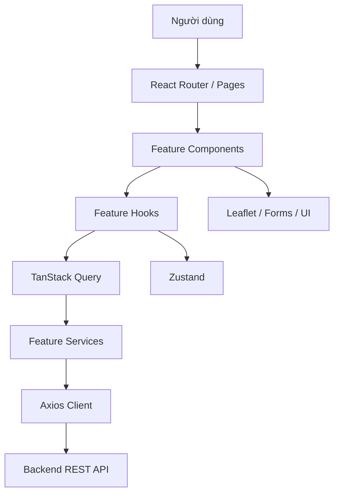
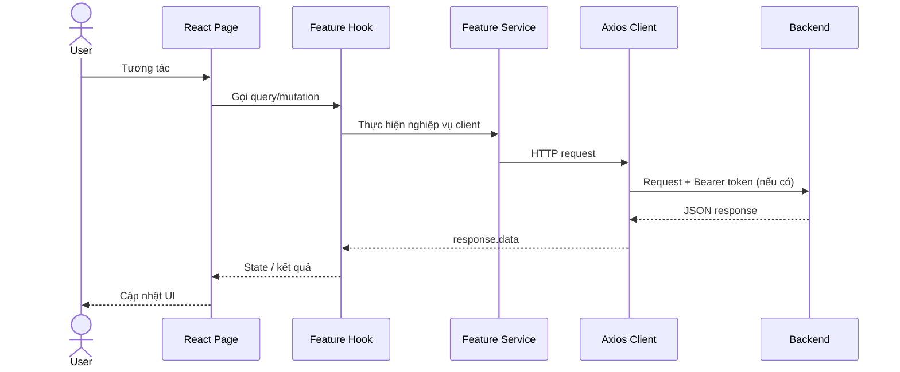

<div align="center">

# Hoverse — Frontend

**Giao diện web khám phá địa điểm, đánh giá trải nghiệm và quản lý cộng đồng tại TP.HCM**

[](./package.json)
[](./package.json)
[](./package.json)
[](./package.json)
[](./package.json)

[Website](https://hoverse.pro.vn) · [Kiến trúc](#kiến-trúc-ứng-dụng) · [Hướng dẫn phát triển](#hướng-dẫn-phát-triển) · [Tích hợp-api](#tích-hợp-api)

</div>

---

## Tổng quan

Hoverse là ứng dụng web hỗ trợ người dùng khám phá các địa điểm ăn uống, vui chơi và giải trí, đồng thời chia sẻ trải nghiệm thông qua đánh giá và hình ảnh. Ứng dụng tập trung vào trải nghiệm tìm kiếm địa điểm, khám phá trên bản đồ và tương tác cộng đồng.

Repository này **chỉ chứa Frontend**. Các nghiệp vụ xác thực, phân quyền, lưu trữ dữ liệu và xử lý API thuộc Backend riêng. Frontend đảm nhiệm giao diện, điều hướng, tương tác người dùng, quản lý trạng thái client, validation và kết nối REST API.

### Chức năng có trong mã nguồn

| Nhóm | Chức năng |
| --- | --- |
| Khám phá | Trang chủ, danh sách địa điểm, lọc/tìm kiếm, chi tiết địa điểm, địa điểm nổi bật theo đánh giá |
| Bản đồ | Hiển thị địa điểm trên Leaflet, định vị người dùng, chọn tọa độ khi thêm địa điểm |
| Tài khoản | Đăng ký, đăng nhập, đăng nhập Google, xác thực email, gửi lại email xác thực |
| Hồ sơ | Xem/cập nhật thông tin, cập nhật avatar, đổi mật khẩu |
| Cộng đồng | Tạo/chỉnh sửa/xóa review, hình ảnh review, lưu địa điểm yêu thích |
| Địa điểm | Tạo địa điểm với hình ảnh, cập nhật địa điểm, theo dõi trạng thái |
| AI | Giao diện yêu cầu gợi ý địa điểm từ Backend |
| Quản trị | Dashboard, quản lý địa điểm, người dùng, review, category và tag |

> Phạm vi xác minh: bảng trên dựa vào các route, component, hook và service hiện diện trong snapshot source code. Không đồng nghĩa mọi tính năng đã được kiểm thử thành công trên production.

## Công nghệ

Phiên bản dưới đây là **version range được khai báo trong `package.json`**, không phải kết quả xác nhận phiên bản cài đặt trên môi trường production.

| Thành phần | Dependency | Phiên bản khai báo |
| --- | --- | --- |
| UI | `react`, `react-dom` | `^19.2.6` |
| Build | `vite` | `^8.0.12` |
| Routing | `react-router-dom` | `^7.17.0` |
| Server state | `@tanstack/react-query` | `^5.101.4` |
| Client state | `zustand` | `^5.0.14` |
| HTTP | `axios` | `^1.17.0` |
| Forms | `react-hook-form` | `^7.84.0` |
| Validation | `zod` | `^4.4.3` |
| Form resolver | `@hookform/resolvers` | `^5.7.1` |
| Styling | `tailwindcss`, `@tailwindcss/vite` | `^4.3.3` |
| Maps | `leaflet`, `react-leaflet` | `^1.9.4`, `^5.0.0` |
| Charts | `recharts` | `^3.10.1` |
| Icons | `lucide-react` | `^1.24.0` |
| Google Login | `@react-oauth/google` | `^0.13.5` |
| Notifications | `react-toastify` | `^11.1.0` |

## Kiến trúc ứng dụng

Ứng dụng được tổ chức theo **feature-based structure**: các nghiệp vụ có module riêng, chứa component, hook, service và schema khi cần. Các thành phần dùng chung nằm ngoài `features/`.



### Phân chia trách nhiệm

- **`pages/`, `features/*/pages/`**: trang tương ứng với route, kết hợp các component và hook.
- **`features/*/components/`**: giao diện chuyên biệt của từng nghiệp vụ.
- **`features/*/hooks/`**: logic kết nối server state, mutation và xử lý dữ liệu phục vụ UI.
- **`features/*/services/`**: gọi API; là điểm kiểm tra đầu tiên khi request sai endpoint, method hoặc payload.
- **`features/*/schemas/`**: schema validation được sử dụng ở các form tương ứng.
- **`store/`**: client state, gồm phiên đăng nhập và trạng thái yêu thích.
- **`api/axiosClient.js`**: cấu hình HTTP dùng chung và xử lý refresh token.
- **`components/`**: UI và component dùng lại giữa nhiều feature.
- **`layouts/`**: bố cục giao diện thường và quản trị.

### Luồng dữ liệu điển hình



## Cấu trúc dự án

```text
.
├── .github/workflows/deploy.yml
├── public/
├── src/
│   ├── api/axiosClient.js
│   ├── assets/
│   ├── components/
│   │   ├── common/
│   │   └── ui/
│   ├── features/
│   │   ├── admin/
│   │   ├── auth/
│   │   ├── category/
│   │   ├── gemini/
│   │   ├── gps/
│   │   ├── place/
│   │   ├── review/
│   │   ├── tag/
│   │   └── user/
│   ├── layouts/
│   ├── pages/
│   │   ├── Home.jsx
│   │   └── MapPage.jsx
│   ├── services/geocodeService.js
│   ├── store/
│   │   ├── useAuthStore.js
│   │   └── useFavoritesStore.js
│   ├── utils/useActionGuard.js
│   ├── App.jsx
│   ├── index.css
│   └── main.jsx
├── .env.development
├── .env.production
├── eslint.config.js
├── jsconfig.json
├── package.json
├── package-lock.json
├── vercel.json
└── vite.config.js
```

`@/` được cấu hình trong `vite.config.js` để trỏ đến `src/`. Ví dụ: `@/features/place/services/placeService`.

## Routing và quyền truy cập

Routes được định nghĩa tại `src/App.jsx`. `ProtectedRoute.jsx` kiểm tra trạng thái người dùng trong Zustand và chuyển hướng khi chưa đủ điều kiện. Đây là **kiểm soát trải nghiệm ở client**, không thay thế authorization trên Backend.

| Route | Trang | Điều kiện tại Frontend |
| --- | --- | --- |
| `/` | Home | Public |
| `/map` | MapPage | Public |
| `/places/:placeId` | PlaceDetail | Public |
| `/login` | Login | Public |
| `/register` | Register | Public |
| `/verify-email` | VerifyEmail | Public |
| `/users/me` | ProfilePage | Đã đăng nhập |
| `/favorites` | PlaceFavorite | Đã đăng nhập |
| `/edit-place/:placeId` | PlaceUpdate | Đăng nhập + xác thực email |
| `/ai` | GeminiRecommendPlace | Đăng nhập + xác thực email |
| `/admin/places` | AdminPlaceManage | `ADMIN` |
| `/admin/users` | AdminUserManage | `ADMIN` |
| `/admin/reviews` | AdminReviewManage | `ADMIN` |
| `/admin/categories` | AdminCategoryManage | `ADMIN` |
| `/admin/tags` | AdminTagManage | `ADMIN` |
| `/admin/dashboard` | AdminDashboard | `ADMIN` |

Admin routes nằm trong `AdminLayout`. Route `/admin` là layout parent; snapshot không định nghĩa index route riêng tại `/admin`.

## Cài đặt và chạy local

### Yêu cầu

- Node.js và npm tương thích với Vite 8 (nên sử dụng phiên bản Node.js được Vite hỗ trợ; kiểm tra `node --version`).
- Backend API đang chạy và cho phép origin của Frontend qua CORS.
- Google OAuth client ID nếu cần thử đăng nhập Google.

### Cài đặt

```bash
npm ci
```

### Cấu hình môi trường

Hai biến môi trường được xác minh từ các file `.env.development`, `.env.production` và source code:

| Biến | Mục đích | Nơi sử dụng |
| --- | --- | --- |
| `VITE_API_URL` | Base URL của Backend API | `src/api/axiosClient.js` |
| `VITE_GOOGLE_CLIENT_ID` | Google OAuth client ID | `src/main.jsx` |

Ví dụ tạo file `.env.local` (điều chỉnh URL cho phù hợp với Backend thực tế):

```dotenv
VITE_API_URL=http://localhost:8088/api/v1
VITE_GOOGLE_CLIENT_ID=your_google_oauth_client_id
```

> URL trên là **ví dụ cấu hình local**, không phải kết quả kiểm tra Backend đang hoạt động. Trong Vite, biến bắt đầu bằng `VITE_` được đưa vào bundle client: không lưu API secret, mật khẩu hoặc private key trong các biến này. Repository có file `.env.development` và `.env.production`; cần kiểm tra chúng trước khi commit vì `.gitignore` không loại trừ `.env.development`.

### Khởi chạy

```bash
npm run dev
```

Vite thường sử dụng `http://localhost:5173` khi port mặc định còn trống. Kiểm tra URL thực tế trên terminal.

### Lệnh thường dùng

```bash
npm run dev       # Development server
npm run lint      # ESLint
npm run build     # Production bundle
npm run preview   # Preview build tại local
```

Các lệnh trên được xác minh từ `package.json`. Không có script `test` trong snapshot.

## Tích hợp API

### HTTP client

`src/api/axiosClient.js` tạo hai Axios instance:

- `axiosClient`: instance dùng cho API nghiệp vụ, tự thêm `Authorization: Bearer <token>` nếu có token.
- `axiosRefresh`: instance riêng gọi `/auth/refresh-token` và không đi qua response interceptor của `axiosClient`.

Cả hai sử dụng `baseURL: import.meta.env.VITE_API_URL` và `withCredentials: true`.

Response interceptor trả thẳng `response.data`; vì vậy service nhận **body đã được giải mã**, không phải Axios response đầy đủ.

### Refresh token khi HTTP 401

1. Request thất bại với status `401`.
2. Nếu request chưa retry và không thuộc nhóm auth được loại trừ, interceptor gọi `POST /auth/refresh-token`.
3. Khi thành công, lưu access token mới vào `useAuthStore`, cập nhật header và gửi lại request cũ.
4. Nếu refresh thất bại, gọi `logout()` và trả lỗi về caller.

`_retry` ngăn cùng request retry vô hạn. Logic hiện tại chưa có cơ chế đồng bộ nhiều request `401` xảy ra cùng lúc; có thể phát sinh nhiều refresh request song song.

### Một số API được xác minh từ service

Đường dẫn dưới đây **tương đối với `VITE_API_URL`**:

| HTTP | Path | Client service |
| --- | --- | --- |
| POST | `/auth/login` | `Login.jsx` |
| POST | `/auth/google` | `Login.jsx` |
| POST | `/auth/refresh-token` | `axiosClient.js` |
| GET | `/places` | `placeService.js` |
| POST | `/places` | `placeService.js` |
| GET | `/places/:placeId` | `placeService.js` |
| PUT | `/places/:placeId` | `placeService.js` |
| GET | `/places/map` | `placeService.js` |
| GET | `/places/top-rating` | `placeService.js` |
| POST | `/places/:placeId/favorite` | `placeService.js` |
| GET | `/favorites` | `placeFavoriteService.js` |
| GET | `/favorites/ids` | `placeFavoriteService.js` |
| GET | `/places/:placeId/reviews` | `reviewService.js` |
| POST | `/places/:placeId/reviews` | `reviewService.js` |
| PATCH | `/places/reviews/:reviewId` | `reviewService.js` |
| DELETE | `/places/reviews/:reviewId` | `reviewService.js` |
| GET | `/users/me` | `profileService.js` |
| PATCH | `/users/me` | `profileService.js` |
| PATCH | `/users/avatar` | `profileService.js` |
| PATCH | `/users/password` | `profileService.js` |
| GET | `/ai/recommend` | `geminiService.js` |
| GET | `/reverse` | `geocodeService.js` |

Đây là danh sách các request có thể xác minh từ Frontend, **không phải tài liệu đầy đủ của Backend API**. Quyền truy cập, HTTP status, validation và payload cuối cùng phải đối chiếu với Backend.

### Upload ảnh

`placeService.createPlace` và `createPlaceByAdmin` sử dụng `FormData`, với:

- Part `place`: `Blob` JSON, MIME type `application/json`.
- Part `files`: các file hình ảnh được append nhiều lần.

Khi thay đổi upload, cần kiểm tra tên part và cấu trúc JSON tương ứng với Backend; không tự đặt `Content-Type: multipart/form-data` thủ công nếu không cần, để trình duyệt/Axios thiết lập boundary phù hợp.

## State management

### Zustand — client state

**`useAuthStore`** quản lý `user`, `token`, các action `login`, `logout`, `setToken`, `update`. Store sử dụng `persist` với key `hoverse-auth` trong `localStorage`.

**`useFavoritesStore`** quản lý `favoriteIds`, `favorites`, đồng thời triển khai optimistic update trong `toggleFavorite`: cập nhật UI trước, gọi API, rollback state nếu request thất bại.

### TanStack Query — server state

`QueryClientProvider` được khai báo tại `src/main.jsx`. Các feature hooks tổ chức việc fetch, mutation và sử dụng dữ liệu từ Backend.

Nguyên tắc mở rộng: dữ liệu do Backend sở hữu nên ưu tiên quản lý bằng TanStack Query; trạng thái UI hoặc client session có thể sử dụng local state/Zustand tùy nhu cầu. Tránh lưu cùng một nguồn dữ liệu ở nhiều store mà không có chiến lược đồng bộ.

## Form và validation

Dự án có React Hook Form, Zod và `@hookform/resolvers`; schema hiện diện trong các module `category`, `tag`, `user`. Không phải mọi form đều sử dụng cùng một cách triển khai: ví dụ `Login.jsx` sử dụng `useState` và kiểm tra đầu vào thủ công.

Khi thêm form mới:

1. Xác định request contract từ Backend.
2. Định nghĩa validation ở client phù hợp với trải nghiệm người dùng.
3. Tách service API khỏi component khi logic có thể tái sử dụng.
4. Hiển thị trạng thái loading, thành công và lỗi.
5. Đảm bảo validation phía Backend vẫn là nguồn kiểm soát cuối cùng.

## Hướng dẫn phát triển

### Tìm đúng vị trí khi cần sửa một chức năng

| Muốn thay đổi | Bắt đầu kiểm tra |
| --- | --- |
| Menu, header, footer | `src/components/common/`, `src/layouts/` |
| Trang chủ | `src/pages/Home.jsx` và `src/features/place/` |
| Định nghĩa route | `src/App.jsx` |
| Chặn truy cập trang | `src/components/common/ProtectedRoute.jsx` |
| Đăng nhập/đăng ký | `src/features/auth/pages/` |
| JWT, refresh, base URL | `src/api/axiosClient.js`, `src/store/useAuthStore.js` |
| Danh sách/lọc địa điểm | `src/features/place/hooks/`, `services/placeService.js` |
| Chi tiết địa điểm | `src/features/place/pages/PlaceDetail.jsx` |
| Tạo địa điểm | `src/features/place/components/AddPlaceModal.jsx` |
| Chọn vị trí trên bản đồ | `src/features/place/components/MapPicker.jsx` |
| Bản đồ khám phá | `src/pages/MapPage.jsx`, `src/features/gps/` |
| Review | `src/features/review/` |
| Danh sách yêu thích | `src/features/place/`, `src/store/useFavoritesStore.js` |
| Hồ sơ và avatar | `src/features/user/` |
| Gợi ý AI | `src/features/gemini/` |
| Dashboard | `src/features/admin/pages/AdminDashboard.jsx` |
| Giao diện quản trị | `src/layouts/AdminLayout.jsx`, các trang `Admin*` |
| Giao diện chung / CSS | `src/index.css`, `src/components/ui/` |

### Quy trình thêm một feature

1. **Xác định scope:** route mới, màn hình mới hay mở rộng feature hiện có?
2. **Kiểm tra API contract:** endpoint, method, request/response và authorization.
3. **Tạo module:** ưu tiên `src/features/<feature>/` nếu nghiệp vụ độc lập.
4. **Tạo service:** định nghĩa HTTP request ở `services/`.
5. **Tạo hook:** quản lý query/mutation và xử lý state liên quan.
6. **Tạo component/page:** ưu tiên component nhỏ, rõ trách nhiệm.
7. **Bổ sung validation:** nếu có dữ liệu người dùng nhập.
8. **Đăng ký route:** tại `src/App.jsx` nếu cần.
9. **Kiểm tra permission:** client guard chỉ hỗ trợ UX; Backend phải xác thực quyền.
10. **Chạy lint/build và thử nghiệm:** bao gồm loading, empty state, error state và responsive mobile.

### Ví dụ: thay đổi bộ lọc địa điểm

```text
src/pages/Home.jsx
    → src/features/place/components/
    → src/features/place/hooks/usePlaceFilter.js
    → src/features/place/services/placeService.js
    → Backend GET /places
```

Cần kiểm tra đồng thời tên query parameter, giá trị mặc định, pagination, cache/query key và khả năng Backend chấp nhận điều kiện mới.

## Authentication và bảo mật

- Google OAuth được khởi tạo bằng `GoogleOAuthProvider` tại `src/main.jsx`.
- `ProtectedRoute` dựa trên `user`, `isEmailVerified`, `role` để điều hướng.
- Axios đính kèm Bearer token từ Zustand vào các request.
- `withCredentials: true` cho phép gửi cookie phù hợp với chính sách của trình duyệt và CORS của server.

**Điểm cần cân nhắc:** `useAuthStore` persist cả access token vào `localStorage`. Token trong localStorage có thể bị truy cập nếu ứng dụng bị XSS; cần đánh giá threat model, CSP, dependency security và chiến lược lưu token. Không được coi việc ẩn admin route ở client là cơ chế bảo vệ dữ liệu.

## Testing và chất lượng mã nguồn

Snapshot có ESLint và script `npm run lint`, nhưng **không có script `npm test` hoặc cấu hình bộ test tự động được xác minh**.

Checklist trước khi merge:

- [ ] `npm run lint` hoàn tất.
- [ ] `npm run build` hoàn tất.
- [ ] Kiểm tra public, authenticated, verified và admin routes.
- [ ] Kiểm tra trạng thái loading/error/empty.
- [ ] Kiểm tra thao tác trên mobile và desktop.
- [ ] Kiểm tra API trả `401`, `403`, `404`, `5xx`.
- [ ] Kiểm tra refresh token và đăng xuất.
- [ ] Kiểm tra upload và bản đồ trên trình duyệt thật.
- [ ] Không commit secret hoặc thông tin nhạy cảm.

Nên bổ sung unit/component tests và E2E tests cho các luồng quan trọng: login, tìm kiếm địa điểm, tạo địa điểm, review, favorite và phân quyền giao diện.

## Build và triển khai

### Production build

```bash
npm ci
npm run build
npm run preview
```

`npm run build` tạo thư mục `dist/` theo cấu hình Vite mặc định. `vercel.json` có rewrite tất cả đường dẫn về `index.html` để hỗ trợ client-side routing trên Vercel.

### GitHub Actions / VPS

Workflow `.github/workflows/deploy.yml` được kích hoạt khi push lên `main`. Workflow kết nối VPS qua SSH, thực hiện `git pull origin main`, `npm ci`, `npm run build` trong `/var/www/hoverse`, sau đó thay `dist-live` bằng `dist` mới.

Workflow sử dụng các GitHub Secrets tên `VPS_HOST`, `VPS_USER`, `VPS_SSH_KEY`. Việc build thành công không tự chứng minh web server đang trỏ đúng vào `dist-live` hoặc đã có cơ chế rollback. Cần kiểm tra cấu hình web server và deployment thực tế trên VPS.

## Troubleshooting

| Triệu chứng | Vị trí kiểm tra trước |
| --- | --- |
| Trang trắng sau deploy | Browser Console, `dist/`, cấu hình SPA rewrite |
| API trả `401` | `useAuthStore`, Bearer token, refresh interceptor |
| API trả `403` | Quyền tài khoản và authorization Backend |
| CORS hoặc cookie không gửi | `VITE_API_URL`, `withCredentials`, CORS, SameSite/Secure |
| Request đi sai host | `.env.*`, `VITE_API_URL`, build environment |
| Đăng nhập Google lỗi | `VITE_GOOGLE_CLIENT_ID`, OAuth origins, Backend auth |
| Map không hiển thị | Leaflet CSS, kích thước container, tile/network |
| Marker không đúng | `MapPage.jsx`, `MapPicker.jsx`, tọa độ và icon |
| Favorite bị sai sau lỗi mạng | `useFavoritesStore.toggleFavorite` và rollback |
| Upload thất bại | `FormData`, tên part, giới hạn file Backend |
| Gợi ý AI chậm/lỗi | `geminiService.js`, Backend, timeout và quota |

### Những vấn đề kỹ thuật cần ưu tiên rà soát

1. **Rules of Hooks:** `ProtectedRoute.jsx` gọi `useEffect` bên trong nhánh `if (requireVerified && !user.isEmailVerified)`. Hook phải được gọi theo thứ tự nhất quán ở top-level của component. Nên refactor để tránh vi phạm Rules of Hooks.
2. **Token persistence:** access token đang được lưu trong `localStorage`; đánh giá lại chính sách bảo mật.
3. **Concurrent refresh:** nhiều request cùng `401` có thể kích hoạt nhiều refresh request. Có thể cần cơ chế single-flight/queue.
4. **Environment hygiene:** `.env.development` có trong snapshot và không nằm trong danh sách ignore cụ thể; kiểm tra dữ liệu được commit.
5. **Test coverage:** chưa xác minh được bộ test tự động; nên bổ sung trước khi mở rộng nghiệp vụ.
6. **Deployment reliability:** workflow thay `dist-live` trực tiếp, chưa thể xác minh health check và rollback.

Các mục này là kết quả review tĩnh, không phải kết luận rằng lỗi đã xảy ra trên production.

## Related Repository

Backend được phát triển độc lập và cung cấp REST API cho ứng dụng này.

- **Backend:** [Project_Hoverse_Backend](https://github.com/ntphoang/Project_Hoverse_Backend)
- **Frontend:** repository chứa README này.

Khi chạy đồng thời ở local, khởi động Backend theo hướng dẫn của Backend repository, sau đó đặt `VITE_API_URL` trỏ đến API base URL tương ứng và chạy `npm run dev`. Cần đảm bảo Backend cho phép origin của Vite dev server và hỗ trợ credentials nếu sử dụng cookie.

## Tác giả và giấy phép

**Phi Hoàng** — Frontend development, API integration và UI engineering cho Hoverse.

**Website:** https://hoverse.pro.vn

**License:** chưa xác minh được file `LICENSE` trong snapshot. Không mặc định dự án là open source chỉ vì repository có thể được truy cập công khai.

---

<div align="center">

**Hoverse Frontend** · React · Vite · JavaScript

*Tài liệu được biên soạn dựa trên cấu trúc và implementation của repository Frontend.*

</div>
